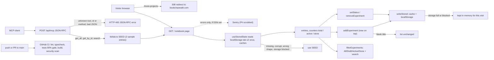
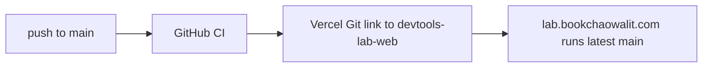

# 01 — Business process (As-Is / To-Be)

devtools-lab-web คือสมุดบันทึกการทดลองฝั่งเบราว์เซอร์ เริ่มด้วยรายการตัวอย่าง 2 รายการ ผู้ใช้เพิ่ม ค้นหา กรองตามสถานะ (Draft, Active, Done) เปลี่ยนสถานะ และลบรายการได้ โดยเก็บใน localStorage ของเบราว์เซอร์เดียว ส่วน `/api/mcp` เปิดเฉพาะรายการตัวอย่าง

Last reviewed: 2026-11-28 · commit `6b9e940`

## As-Is (จากโค้ดวันนี้)

Sources: `lib/lab.ts`, `lib/use-stored-state.ts`, `app/page.tsx`, `app/api/mcp/route.ts`, `next.config.ts`, `lib/sentry.ts`, `.github/workflows/ci.yml`, `README.md`, `PRODUCT.md`

ข้อเท็จจริงสำคัญจากโค้ด:

- รายการที่ผู้ใช้เพิ่มอยู่ในเบราว์เซอร์เท่านั้น MCP มองไม่เห็น; ไม่มี export หรือ sync
- ไม่มี workflow deploy ใน repo; ตาม PRODUCT.md (2026-10-23) deploy ด้วย Vercel CLI และ Git link ชี้ repo เก่า [ต้องยืนยัน] สถานะวันนี้
- PRODUCT.md ระบุ Vercel Analytics แต่ไม่พบการใช้งานใน `app/`, `components/`, `package.json` ของ commit นี้ [ต้องยืนยัน]
- `NEXT_PUBLIC_SENTRY_DSN` บน production: [ต้องยืนยัน]

## To-Be (จาก PRODUCT.md §Live URL and deploy state)

Sources: `PRODUCT.md` (owner action D9)

## Gap

| ID | As-Is → To-Be | Status | Owner | Evidence |
|---|---|---|---|---|
| G1 | deploy ด้วย CLI และ Git link ชี้ repo เก่า (site ตามหลัง main) → เชื่อม Vercel Git กับ `devtools-lab-web` | decide | owner | `PRODUCT.md` owner action D9 [ต้องยืนยัน] สถานะปัจจุบัน |

## Open questions

- Vercel Git link ของโปรเจกต์ `bookchaowalit-lab-frontend` ยังชี้ repo เก่าอยู่หรือไม่
- `NEXT_PUBLIC_SENTRY_DSN` ตั้งบน production หรือไม่
